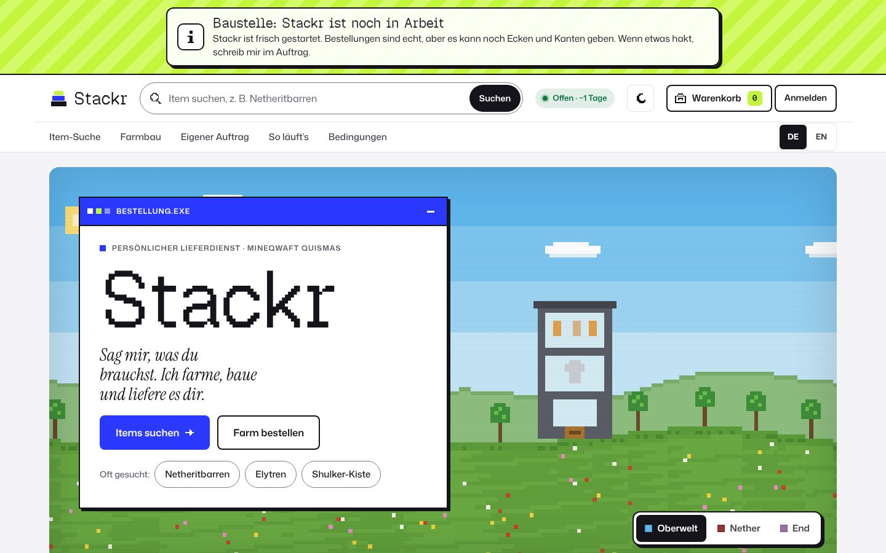
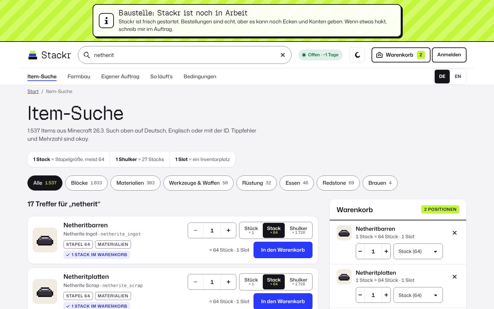
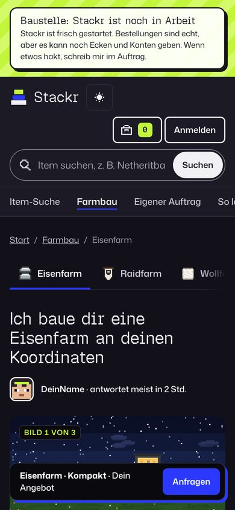

# Stackr

A personal order board for the **Mineqwaft Quismas** Minecraft server. Players search any item, fill a cart and send one order, or request a farm built at their coordinates. One seller, German first (DE/EN).

**Live:** [stackr-alpha.vercel.app](https://stackr-alpha.vercel.app)

> [!NOTE]
> Stackr is a working personal project for one community server, not a general marketplace. There is exactly one seller, payment is agreed in-game (items, favours), and nothing is sold for real money. It is not an official Minecraft service and not affiliated with Mojang or Microsoft.



<table>
  <tr>
    <td width="72%"></td>
    <td></td>
  </tr>
</table>

## What it does

**For players**
- Search all 1,537 survival-obtainable items of Minecraft Java 26.3 in German, English or by item id. Typos and plurals are fine.
- Add items to a cart in pieces, stacks or shulker boxes, then place everything as one order with delivery coordinates.
- Request farms (iron, raid, wool, stone, tree, gold) in three tiers, or describe a custom job.
- Follow each order through a 7-step tracker, chat with the seller, approve or complain, and rate.

**For the seller (Backstage)**
- Order queue with filters, terms (price and days) per order, delivery in batches, and shop switches (accepting, vacation).
- Client list: confirm Minecraft names, create invite and password-reset codes, give tokens, block clients.
- Reputation and levels for seller and clients are computed from finished orders.

## Accounts and trust

- **Sign-up:** players use their Minecraft name and a password. The name must exist (checked against Mojang's public name lookup), and each name can hold only one account.
- **Name confirmation:** new names show as *not confirmed* until the seller confirms them after meeting the player in-game.
- **Invite codes:** the seller can create a code bound to one name and send it in-game with `/msg`. Signing up with it confirms the name immediately, and it can take a name back from an unconfirmed impostor.
- **Forgotten passwords:** reset with a one-time code from the seller. There is no email anywhere.
- **Seller account:** claimed once with a secret setup code and protected by an authenticator app (TOTP) with recovery codes.

## Security and privacy

- **Cookies and passwords:** sessions use one `__Host-` cookie that is HttpOnly, Secure and SameSite. The server stores only hashes of session tokens, and passwords are hashed with scrypt.
- **Server-side checks:** every input is validated with [zod](https://zod.dev) and length limits. The acting user always comes from the session, never from the request.
- **Per-person data:** each person receives only their own data. Other players' orders reach the browser only as anonymous stubs (status, dates, stars).
- **Abuse protection:** rate limits per IP hash, per account and globally, plus CSRF checks on every write (Origin, a custom header and a JSON-only body).
- **Strict headers:** CSP, HSTS and frame/referrer/permissions policies (see [`vercel.json`](vercel.json)).
- **No third parties:** fonts are self-hosted, with no trackers or external scripts.
- **GDPR:** a privacy page in German and English, data export, account deletion, and automatic retention cleanup (daily cron).

## How it's built

| Part | What |
| --- | --- |
| Frontend | React 18 single-page app, Vite 7, TypeScript (strict), hash routing, no UI framework |
| Backend | One Vercel Function ([`api/index.ts`](api/index.ts) → [`server/`](server)) in Frankfurt (`fra1`) |
| Database | Postgres on Neon. Shop data is one versioned JSON document with optimistic locking; sessions, passwords, codes, 2FA, rate limits and the audit log live in their own tables |
| Shared rules | All business rules are pure functions in [`src/data/actions.ts`](src/data/actions.ts), run by the server in live mode and by the browser in beta mode |

The full list of API routes is in the header of [`server/routes.ts`](server/routes.ts).

**Beta fallback:** without a configured database the API answers "beta", and the site runs entirely in the browser with example data in `localStorage`. This is how it ran before the backend existed, and it is still what `npm run dev` gives you on its own.

## Run it locally

Requires **Node.js 20.19+ or 22.12+** (CI uses 22) and npm.

```bash
npm ci
npm run dev            # http://localhost:5173, beta mode (browser only)
```

For the full stack with the real API and an in-memory Postgres ([PGlite](https://pglite.dev)), start the API in a second terminal:

```bash
npm run dev:api        # API on http://localhost:3001; Vite proxies /api to it
```

In this local mode:
- Mojang's name lookup is faked: every name exists except names starting with `Nobody`.
- To create the seller account, register with the invite code `dev-setup-code-123456`.
- All data is lost when the API stops. Set `PGLITE_DIR` to a folder to keep it.

### Checks

```bash
npm run typecheck      # frontend + server
npm run test:api       # API tests (auth, 2FA, permissions, data isolation, limits, GDPR)
npm run build          # typecheck + production build into dist/
```

CI ([`.github/workflows/ci.yml`](.github/workflows/ci.yml)) runs `npm audit`, the type check, the API tests and the build on every push and pull request.

## Deployment

Vercel builds every push to `main` (`npm run build`, output `dist/`, see [`vercel.json`](vercel.json)). Set these in Vercel → Settings → Environment Variables, for **Production** only:

| Variable | Type | Required | Purpose |
| --- | --- | --- | --- |
| `DATABASE_URL` | Secret | yes | Neon connection string; added by the Neon integration |
| `APP_SECRET` | Secret | yes | At least 32 random characters. Root key for session, IP and code hashing and 2FA encryption. Changing it signs everyone out and resets the seller's 2FA |
| `CRON_SECRET` | Secret | yes | Vercel Cron sends it to `/api/cron` (daily cleanup at 03:17 UTC) |
| `SELLER_SETUP_CODE` | Secret | yes | At least 16 characters. Entered once as the invite code to claim the seller account; also resets the seller password (2FA still applies) |
| `VITE_PRIVACY_CONTACT` | Config | no | Contact shown on the privacy page; read at build time |

Without `DATABASE_URL` and `APP_SECRET`, production runs in beta mode. Generate secrets with `openssl rand -base64 48`. Environment variable changes need a redeploy.

**First start:**
1. Open the site and go to **Anmelden → Konto erstellen**.
2. Register with your Minecraft name, a password, and `SELLER_SETUP_CODE` as the invite code.
3. Set up the authenticator app and store the recovery codes.

**Backups:** [`.github/workflows/backup.yml`](.github/workflows/backup.yml) runs nightly. It dumps the database, encrypts the dump with AES-256 and keeps it as a workflow artifact for 30 days.
- It needs the repository secrets `BACKUP_PASSPHRASE` and either `BACKUP_DATABASE_URL` (preferred, a read-only role) or `DATABASE_URL`. Without them the job skips.
- To restore, use [`deploy/db/restore.sh`](deploy/db/restore.sh).
- Least-privilege database roles are in [`deploy/db/roles.sql`](deploy/db/roles.sql).

## Updating the item list

[`scripts/build-items.mjs`](scripts/build-items.mjs) builds the item list from [misode/mcmeta](https://github.com/misode/mcmeta) (data generated from Mojang's game files), with German names from Mojang's language assets:

```bash
node scripts/build-items.mjs 26.3 > public/items-26.3.json
```

For a new Minecraft version, change the file name in [`src/domain/items.ts`](src/domain/items.ts), [`server/items.ts`](server/items.ts) and the `includeFiles` entry in [`vercel.json`](vercel.json).

## Project layout

```text
api/            Vercel Function entry
server/         API: routes, auth, sessions, 2FA, rate limits, data views, tests, local dev server
src/domain/     types, business rules, catalog, item search
src/data/       actions (state changes), commands, store, API client
src/pages/      Home, item search + cart, farms, orders, account, Backstage
src/ui/         layout, router, components, pixel art
public/         item list, self-hosted fonts, favicon
deploy/db/      database roles and restore script
```

## Contributing

This is a personal project for one server and isn't set up for outside contributions.
<!-- TODO: decide whether issues/PRs are welcome and say so here. -->

## License

<!-- TODO: no LICENSE file yet. The repository is public; without a license, all rights are reserved by default. -->
No license has been chosen yet.

## Credits

- Fonts, all under the SIL Open Font License (licence texts in [`public/fonts`](public/fonts)):
  - [Geist Pixel](https://vercel.com/font) by Vercel with basement.studio
  - [Mona Sans](https://github.com/github/mona-sans) by GitHub
  - [Instrument Serif](https://github.com/Instrument/instrument-serif) by the Instrument Serif Project Authors
- Item data: [misode/mcmeta](https://github.com/misode/mcmeta), generated from Mojang's game data. No game textures are used; all pixel art is original.
- Minecraft is a trademark of Mojang AB. Stackr is not affiliated with or endorsed by Mojang or Microsoft.
